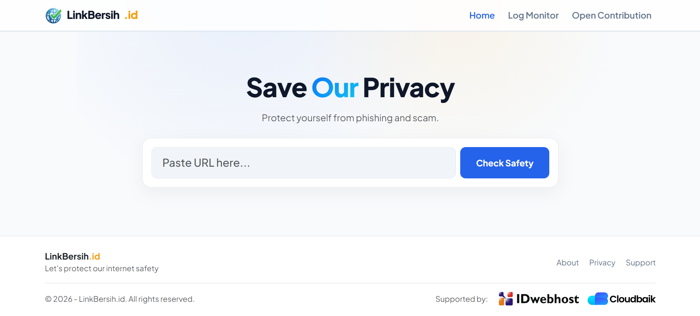
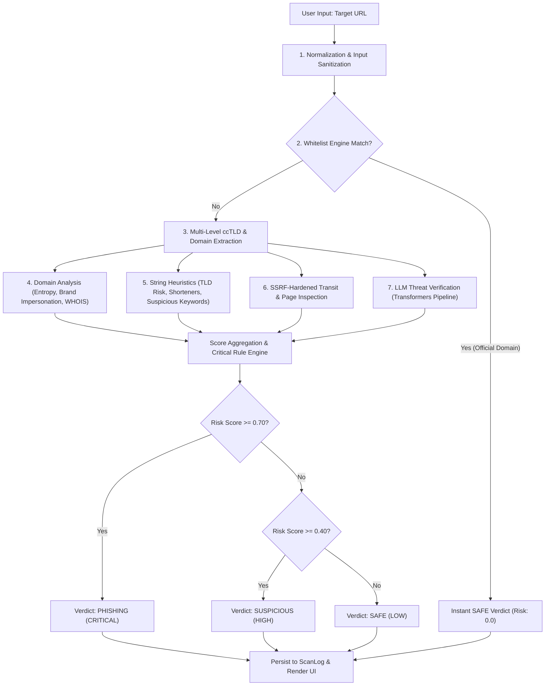

# LinkBersih 🛡️

> **Next-Generation Phishing & Scam URL Detection Platform**  
> An open-source, privacy-first cybersecurity web application engineered to protect internet users from malicious links, credential harvesters, and digital fraud.

---

## 📸 Product Interface & Visual Overview



### Interface Background & Design Rationale
The screenshot above from the [`assets/LinkBersih-Pages.png`](assets/LinkBersih-Pages.png) file illustrates the core user journey of **LinkBersih**:

1. **The Hero & Input Console (Top View):**
   - Designed around the motto *"Save Our Privacy — Protect yourself from phishing and scam."*
   - Features a clean, single-input search container engineered for zero friction. Users simply paste any suspicious URL (with or without protocol) and receive instant, definitive verdicts without registration or personal data submission.
   - Styled with modern, accessible typography (*Plus Jakarta Sans*) and high-contrast alert states to ensure clarity even under stressful user situations.

2. **Real-Time Threat Intelligence & Verdict Cards (Middle View):**
   - Translates dense, multi-layer telemetry into three intuitive classifications: **SAFE (Aman)**, **SUSPICIOUS (Mencurigakan)**, and **BERBAHAYA/PHISHING**.
   - Highlights the evaluated **Risk Score** (0.0 to 1.0) and **Threat Level** (`LOW`, `HIGH`, `CRITICAL`).
   - Provides plain-language defensive advice (e.g., warning users against entering OTPs, WhatsApp numbers, identity numbers (NIK/KTP), or passwords on suspicious destinations).

3. **Public Community Monitor / Log Explorer (Bottom View):**
   - Displays real-time, anonymized scans on the `/logger/` page.
   - Equips internet communities, researchers, and security teams with instant visibility into newly reported malicious campaigns, complete with classification badges, chronological timestamps, domain query search, and status filtering.

---

## 🎯 Purpose & Mission: Why LinkBersih?

In an increasingly digital landscape—particularly across Southeast Asia and Indonesia—phishing, social engineering scams, and predatory online gambling lures have grown exponentially. Attackers routinely clone national banking portals (BCA, Mandiri, BRI, BNI), fintech e-wallets (GoPay, OVO, DANA), logistics services, and government portals.

**LinkBersih** was created to address three fundamental challenges:

- **Democratizing Threat Intelligence:** Enterprise-grade URL scanners are typically locked behind expensive corporate firewalls or complex developer APIs. LinkBersih offers a fast, free, open-access web UI for everyone.
- **Strict Privacy & Zero-Data Collection:** Built in compliance with modern privacy principles (such as Indonesia's Personal Data Protection Law / UU PDP), LinkBersih collects **no** Personally Identifiable Information (PII), no user IP logs, and no browsing history. Only the scanned URL and threat metrics are processed.
- **Hybrid Heuristic + AI Detection:** Instead of relying on static blocklists that lag behind zero-day domains, LinkBersih employs multi-stage static analysis, SSRF-hardened transit probing, multi-part ccTLD extraction, brand impersonation detection, and LLM reasoning.

---

## ⚙️ The Analysis Pipeline: How It Works

When a user submits a URL, LinkBersih executes an asynchronous 7-stage analytical pipeline:



### Detailed Pipeline Stages

1. **Protocol Normalization & Protocol Guard ([`normalize_url`](file:///home/miroslav/LinkBersih/apps/core/services.py#L442)):**
   - Sanitizes input, enforces `http` or `https` schemes, and immediately blocks dangerous pseudo-protocols like `javascript:`, `file:`, `ftp:`, or `data:`.

2. **Official Whitelist Matching ([`is_whitelisted`](file:///home/miroslav/LinkBersih/apps/core/services.py#L552)):**
   - Evaluates the registered domain against a verified index of official banking, e-commerce, streaming, and government endpoints. Whitelisted domains bypass transit inspection to eliminate false positives and optimize response latency.

3. **ccTLD-Aware Domain Extraction ([`extract_domain_parts`](file:///home/miroslav/LinkBersih/apps/core/services.py#L461)):**
   - Recognizes multi-level national suffixes (`.co.id`, `.web.id`, `.ac.id`, `.go.id`, `.co.uk`, `.com.au`, etc.). Extracts the true registered domain and label so secondary checks (WHOIS queries, Levenshtein distance) evaluate `klikbca.co.id` rather than truncating to `"co.id"`.

4. **Domain & Brand Impersonation Checks ([`analyze_domain`](file:///home/miroslav/LinkBersih/apps/core/services.py#L580)):**
   - **Shannon Entropy:** Detects machine-generated or randomized domains (DGA) with entropy $> 3.8$.
   - **Target Brand Matching:** Flags typosquatting and keyword hijacking targeting major Indonesian institutions (e.g. `bca-secure-login.xyz`, `goog1e.xyz`, `bri-promo.co.id`).
   - **WHOIS Age Telemetry:** Identifies newly minted domains registered within 30 to 90 days.

5. **String Heuristics ([`analyze_string`](file:///home/miroslav/LinkBersih/apps/core/services.py#L905)):**
   - Detects URL shortener platforms (`bit.ly`, `tinyurl.com`, `is.gd`), high-risk TLDs (`.xyz`, `.top`, `.tk`), insecure HTTP protocol, and social engineering keywords (`login`, `verification`, `claim`, `bonus`, `maxwin`, `wallet`).

6. **SSRF-Defended Transit & DOM Inspection ([`inspect_transit_and_page`](file:///home/miroslav/LinkBersih/apps/core/services.py#L985)):**
   - **SSRF Defense:** Uses Python's `socket` and `ipaddress` libraries to perform DNS pre-checks on each hop, blocking attempts to connect to private subnets (`10.0.0.0/8`, `192.168.0.0/16`, `172.16.0.0/12`), loopback (`127.0.0.1`), or cloud metadata endpoints (`169.254.169.254`, `metadata.google.internal`).
   - **Safe Redirection:** Manually follows HTTP redirects hop-by-hop (up to 5 hops) with intermediate IP re-validation.
   - **DOM Inspection:** Analyzes HTML payloads up to a 2 MB ceiling to detect password harvest fields, meta-refresh redirect tricks, hidden iframes, and cross-domain phishing links.

7. **Contextual LLM Reasoning ([`analyze_with_llm`](file:///home/miroslav/LinkBersih/apps/core/services.py#L1375)):**
   - HuggingFace Seq2Seq pipeline (`google/flan-t5-base`) processes URL context to identify subtle social engineering vectors that static regexes might miss.

---

## 🧰 Technology Stack

| Layer | Technologies |
| :--- | :--- |
| **Backend Framework** | [Django 6.1](https://www.djangoproject.com/) (Python 3.13) |
| **Package Management** | [uv](https://docs.astral.sh/uv/) (Fast Python package & project manager) |
| **AI & NLP Pipeline** | [LangChain](https://www.langchain.com/), [Transformers](https://huggingface.co/docs/transformers/index) (`flan-t5-base`), LangChain MistralAI |
| **Security & Parsing** | [BeautifulSoup4](https://www.crummy.com/software/BeautifulSoup/), [Levenshtein](https://github.com/maxbachmann/Levenshtein), [python-whois](https://pypi.org/project/python-whois/), Python `ipaddress` & `socket` |
| **Frontend UI** | Django Server-Side Templates, [Bootstrap 5.3](https://getbootstrap.com/), Google Fonts (*Plus Jakarta Sans*), Vanilla JS |
| **Caching & Rate Limiting**| Django Cache Backend (LocMemCache / Redis-compatible) |
| **Database** | SQLite (Development) / PostgreSQL-ready (Production via `DATABASES` env) |
| **Production Server** | [Uvicorn](https://www.uvicorn.org/) (ASGI) / Gunicorn (WSGI) |

---

## 🔐 Configuration & Environment Variables

Create a `.env` file in the root directory based on [`.env.example`](file:///home/miroslav/LinkBersih/.env.example):

```bash
cp .env.example .env
```

| Variable | Description | Default | Required in Production |
| :--- | :--- | :--- | :--- |
| `DJANGO_SECRET` | Secret key for cryptographic signing & sessions | Dev key fallback | **Yes** |
| `DEBUG` | Enable/disable detailed stack traces | `True` | Must be `False` |
| `ALLOWED_HOSTS` | Comma-separated list of allowed hostnames | `localhost,127.0.0.1` | **Yes** |
| `DJANGO_SETTINGS_MODULE` | Active Django settings module | `config.settings.dev` | Use `config.settings.prod` |
| `SECURE_SSL_REDIRECT` | Enforces HTTPS redirection in production | `True` | Recommended `True` |

---

## 🚀 Quickstart & Local Setup

### 1. Prerequisites
- **Python >= 3.13**
- **uv** (recommended) or standard `pip`

```bash
# Install uv if you don't have it installed
curl -LsSf https://astral.sh/uv/install.sh | sh
```

### 2. Clone and Install Dependencies
```bash
git clone https://github.com/RahmanDevs/LinkBersih.git
cd LinkBersih

# Synchronize virtual environment using uv
uv sync
```

### 3. Initialize Database Migrations
```bash
uv run python manage.py migrate
```

### 4. Run Development Server
You can launch the server using the provided [`Makefile`](file:///home/miroslav/LinkBersih/Makefile) command:
```bash
make dev
# Alternatively:
# uv run python manage.py runserver 127.0.0.1:8000
```
Open your browser at **[http://127.0.0.1:8000/](http://127.0.0.1:8000/)**.

---

## 🧪 Automated Testing & Security Verification

LinkBersih includes an automated test suite comprising **26 test cases** covering SSRF defenses, ccTLD parsing, heuristic boundary conditions, rate limiting, and logger pagination.

To execute the test suite:

```bash
make test
# Alternatively:
# uv run python manage.py test apps.core.tests apps.logger.tests
```

### Test Scope Summary
- **SSRF Defense Tests ([`apps/core/tests.py`](file:///home/miroslav/LinkBersih/apps/core/tests.py)):** Verifies blocking of loopback addresses (`127.0.0.1`), private RFC1918 subnets, cloud metadata (`169.254.169.254`), and non-HTTP schemes.
- **Classification Scoring Logic:** Validates risk threshold monotonicity (ensuring high risk scores evaluate strictly to `PHISHING` and never to `SAFE`).
- **Domain Extraction & Brand Impersonation:** Tests multi-level ccTLD parsing (`klikbca.co.id`, `portal.ac.id`, `bank.co.uk`) and token matching for top Indonesian brands.
- **Input Resilience & Error Handling:** Validates that malformed inputs return user-friendly notices without triggering uncaught HTTP 500 errors.
- **Log Monitor & Pagination ([`apps/logger/tests.py`](file:///home/miroslav/LinkBersih/apps/logger/tests.py)):** Tests search queries, status filters, and page index resiliency.

---

## 📄 License & Open Contribution

This project is open-source under the [MIT License](LICENSE). Contributions, bug reports, and pull requests are welcomed to help keep the internet clean and safe for everyone!
